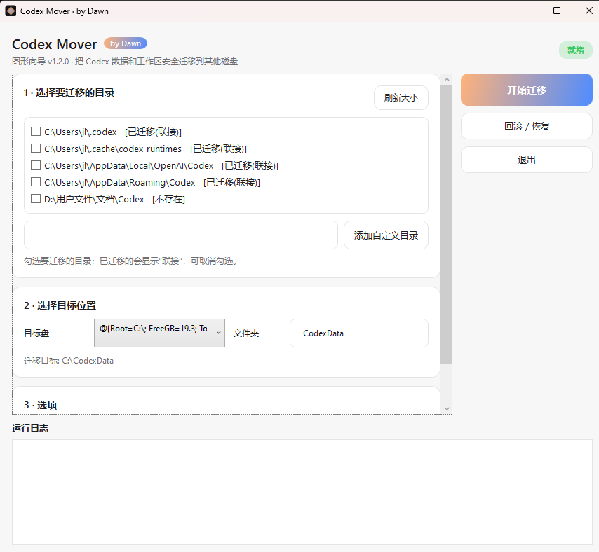
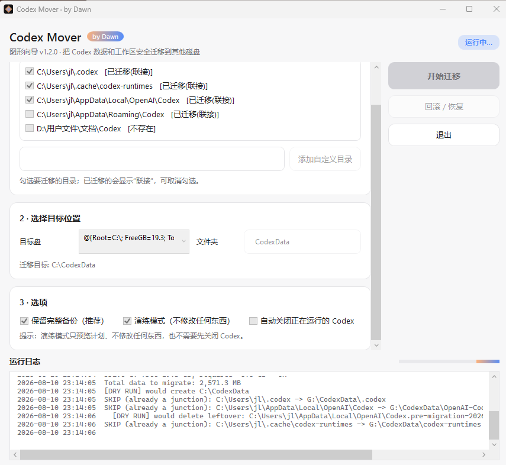
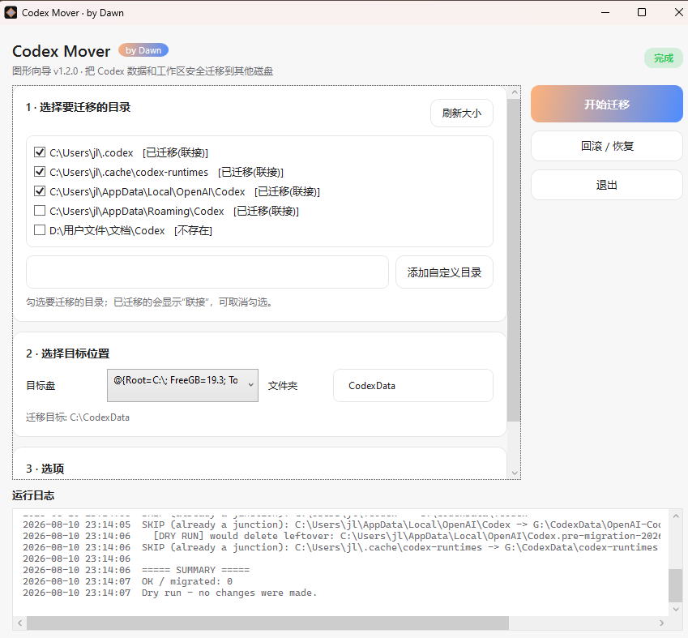

# Codex Mover · by Dawn


便携版 Windows 工具 / Portable Windows tool

把 Codex 的数据与工作区从爆满的 C 盘迁移到另一个盘（如 G 盘）。原路径保留为**目录联接（junction）**，Codex 无需任何配置即可继续工作。全程带备份、逐项校验与自动回滚。

Move Codex data and workspace folders off a full C: drive to another drive. Original paths stay valid as directory junctions, so Codex keeps working without configuration changes. Every step is backed up, verified, and rolled back on failure.

## 界面预览 / Screenshots

| 主界面 / Main | 运行中 / Running | 完成 / Done |
| --- | --- | --- |
|  |  |  |

## 迁移内容 / What gets moved

默认迁移以下目录（GUI 里可以取消勾选）:

| C: 路径 | 说明 |
| --- | --- |
| `%USERPROFILE%\.codex` | 配置、会话、日志、skills、插件缓存、登录凭证 |
| `%USERPROFILE%\.cache\codex-runtimes` | 运行时缓存 |
| `%LOCALAPPDATA%\OpenAI\Codex` | 桌面应用本地数据 |
| `%APPDATA%\Codex` | 桌面应用漫游数据 |
| `%USERPROFILE%\Documents\Codex` | 桌面应用默认工作区（新对话的项目文件） |

## 使用 / Usage

### 图形向导（推荐）/ GUI wizard

WPF 图形向导（Dawn 极简深色界面，v1.2.0）:

1. 完全退出 Codex（含系统托盘图标）。
2. 双击 `CodexMover-GUI.cmd`。
3. 勾选要迁移的目录、选择目标盘，按需勾选“自动关闭 Codex”，点击“开始迁移”。
4. 运行日志实时滚动，右上角状态徽章变绿“完成”后重新打开 Codex。

### 命令行 / Console

```powershell
# 先演练一遍（不修改任何东西）
powershell -NoProfile -ExecutionPolicy Bypass -File .\codex-mover.ps1 -TargetRoot G:\CodexData -DryRun

# 正式迁移
powershell -NoProfile -ExecutionPolicy Bypass -File .\codex-mover.ps1 -TargetRoot G:\CodexData
```

## 安全机制 / Safety

- 先复制到目标盘并校验（文件数、字节数、robocopy 反向对比），确认一致才动原目录。
- 原目录先改名、后建联接；备份再次校验后才释放 C 盘副本。
- 任何失败自动回滚；中断后可自动从备份修复缺失文件。
- 运行日志保存在目标盘 `migration-<时间戳>.log`，GUI 内同步滚动显示。

## 验证 / Verify

```powershell
Get-Item C:\Users\<you>\.codex | Format-List LinkType,Target
```

应显示 `LinkType : Junction`，`Target` 指向目标盘。

## 回滚 / Restore

```powershell
powershell -NoProfile -ExecutionPolicy Bypass -File .\codex-mover.ps1 -TargetRoot G:\CodexData -Restore
```

## 安装 skill / Install the skill

- 双击 `install.cmd` 安装捆绑的 `codex-mover` skill 到 `~/.codex/skills`（该目录现在通常已通过联接位于目标盘）。
- 或从 GitHub 用官方 skill-installer 安装（skill 仓库：`codex-mover-skill`）：

```text
install-skill-from-github.py --repo ZhaowTao/codex-mover-skill --path codex-mover
```

## 注意事项 / Notes

- 仅 Windows。macOS/Linux 请改用 `CODEX_HOME` 环境变量（无需联接）。
- 目录联接是社区验证的通用方案；官方 App 尚未正式支持迁移（openai/codex issue #34070）。
- 迁移后先保留 `G:\CodexData\_backup-*` 几天，确认稳定后再删除。
- 迁移中断后可能出现 `*.pre-migration-*` 残留目录，不影响使用；重启后可删除，或由后续运行自动清理。
- GUI 需要 Windows PowerShell 5.1 与 .NET Framework 4.x（Windows 10/11 自带）。

## 许可 / License

MIT